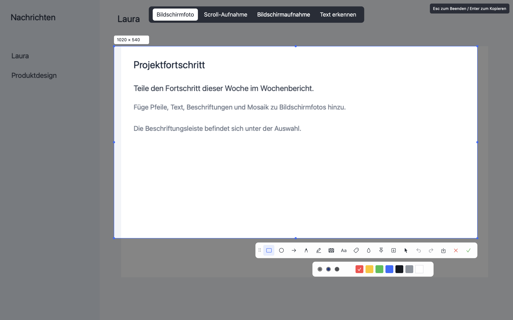
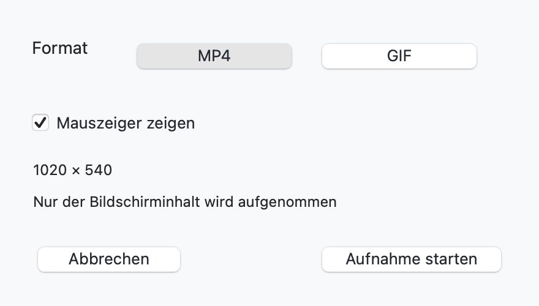
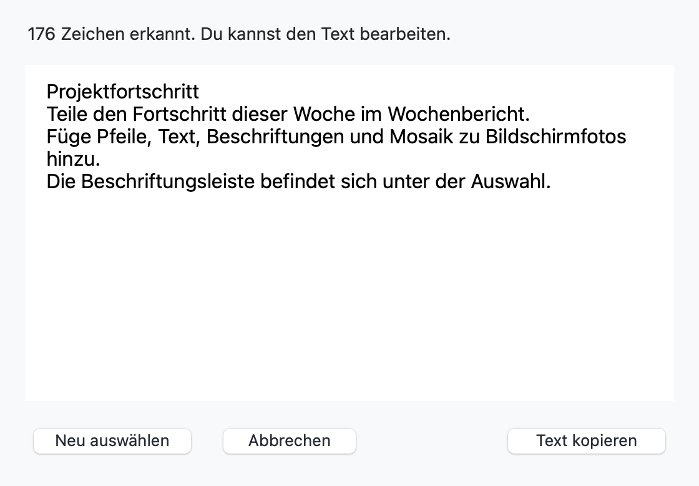
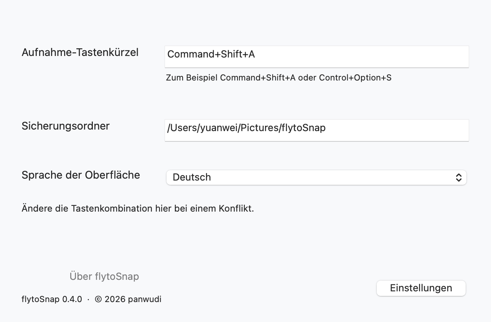
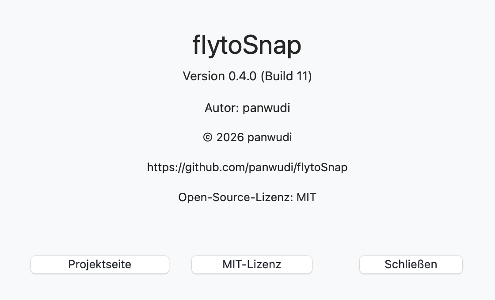

# flytoSnap

**[简体中文](README.zh-CN.md) | [繁體中文](README.zh-TW.md) | [English](README.en.md) | [日本語](README.ja.md) | [Русский](README.ru.md) | [Français](README.fr.md) | [Español](README.es.md) | [Português](README.pt.md) | [Deutsch](README.de.md) | [한국어](README.ko.md)**

[flytoSnap](README.md)

Ein Werkzeug für Bildschirmfotos und Aufnahmen unter macOS, entwickelt mit Rust und AppKit.

macOS 14+ · Apple Silicon · MIT

[Neueste Version herunterladen](https://github.com/panwudi/flytoSnap/releases/latest)

Entpacke die ZIP-Datei und verschiebe die App nach Programme. Sie startet in der Menüleiste.

## Verwendung

`Command+Shift+A` öffnet die Modusauswahl. Wähle anschließend einen Bereich.

Anmerkungen, Scroll-Aufnahmen, MP4/GIF-Aufnahmen und lokale Texterkennung.

Wähle die Sprache in den Einstellungen. Update-Fenster verwenden dieselbe Sprache.

## Über die App

Hier stehen Version, Build, Autor, Copyright und die Links zum Projekt.

[GitHub](https://github.com/panwudi/flytoSnap) · [MIT](LICENSE)
