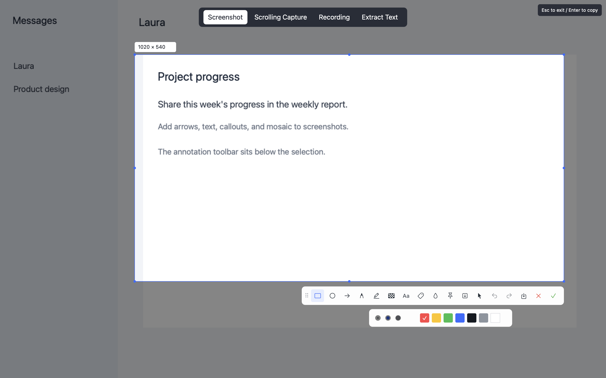
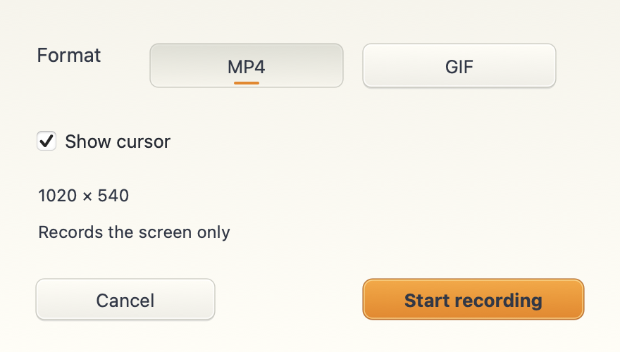
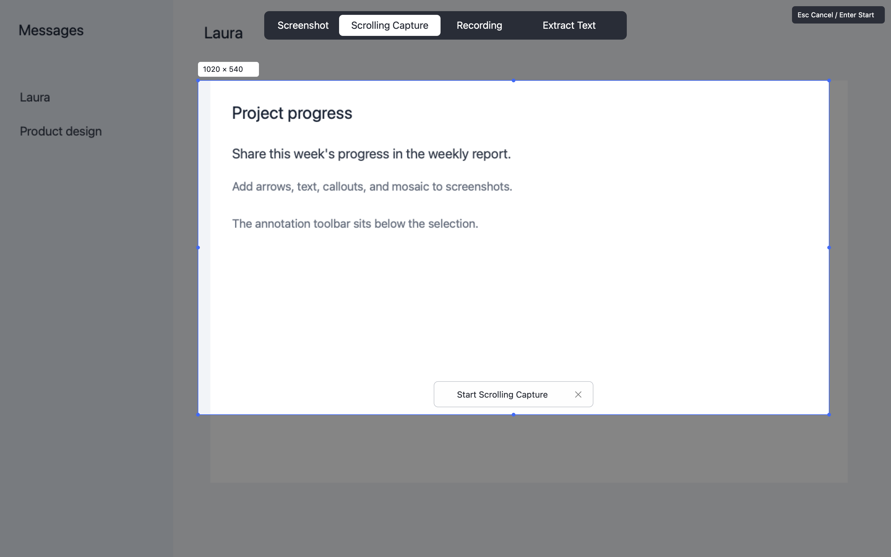
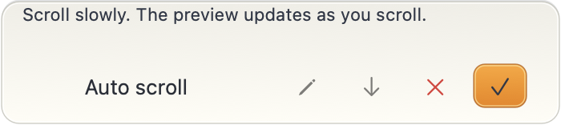

# flytoSnap

[简体中文](README.md) | [繁體中文](README.zh-TW.md) | English

A native macOS screenshot and recording tool written in Rust. One shortcut opens a mode selector for screenshots, scrolling capture, recording, and text extraction.

Requires macOS 14+. The interface supports Simplified Chinese, Traditional Chinese, and English, following the system language by default. The app starts in the menu bar without opening a main window.



## Features

- Capture: Window detection, freeform region selection, magnifier, and eight resize handles. The area outside the selection dims; the cursor changes over buttons, edges, corners, and text.
- Annotate: Rectangles, ellipses, arrows, pen, highlight, brush and rectangle mosaic, text, callouts, and watermark. Undo, redo, and edit existing objects.
- Pin: Floating images with drag, zoom, opacity, lock, copy, and save.
- Scrolling capture: Select a region, click Start Scrolling Capture, then scroll manually or automatically. Compact controls and a side preview stay visible. Supports bidirectional stitching, deduplication, edit, save, and copy.
- Record: Select a region, choose MP4 or GIF, and optionally include the cursor. Preview, save, or copy the finished recording to apps that accept files.
- Extract text: On-device Apple Vision with editable results and copy. No separately downloaded model.



Confirm the region before starting, then choose automatic scrolling:





These are offscreen captures of the application's native controls, using built-in example data.

## Build and use

Requires a Rust toolchain and the macOS SDK.

```sh
bash scripts/build-app.sh
open dist/flytoSnap.app
```

The build script produces a locally signed `.app`, app icons, and a ZIP test package. Grant Screen Recording permission for the first capture or recording; you may need to reopen the app after granting permission. Auto scroll additionally needs Accessibility permission.

At startup, the app checks and requests Screen Recording access if it has not been granted. Existing grants do not prompt again. Cancel from the menu bar, Escape, or the capture shortcut. Normal capture dismisses when switching apps; scrolling controls stay visible over the source app. Reopening the running app shows its action menu without opening a main window.

The default shortcut is `Command+Shift+A`. Select one of the four modes at the top of the capture overlay. Every tool has a hover label. Change the shortcut, save folder, and interface language in menu bar Settings.

| Action | Shortcut |
| --- | --- |
| Open capture and mode selection | `Command+Shift+A` |
| Copy screenshot | `Enter` or `Command+C` |
| Save screenshot | `Command+S` |
| Undo / redo | `Command+Z` / `Command+Shift+Z` |
| Exit capture | `Escape` |
| Quit the app | `Command+Q` |

Scroll over pinned images to zoom, Option+scroll to adjust opacity, and right-click for actions. Recording copy uses the macOS file clipboard; GIF also provides animated image data. Paste behavior depends on the receiving app's supported formats. Recording files remain in the local cache so copied files remain available for pasting.

## Screen access fails after an upgrade

Older test packages used ad-hoc signing. New packages use an available stable developer certificate. This identity transition requires permission again. The app offers Open System Settings, Show This App, and Check Again without resetting system permissions.

1. Quit flytoSnap from the menu bar. Place the new app in a consistent location, preferably `/Applications/flytoSnap.app`.
2. Open System Settings -> Privacy & Security -> Screen & System Audio Recording (Screen Recording on older systems).
3. If flytoSnap is already enabled but capture still fails, remove the old entry. Use `+` to add the current app and enable it.
4. Quit completely and reopen. Enabling an entry for an older build may not authorize the new app.

The build script prefers a local Developer ID Application certificate, then Apple Development. Set `FLYTOSNAP_SIGNING_IDENTITY` to choose a certificate name or fingerprint. Without a valid certificate, it falls back to ad-hoc signing with a warning, and upgrades may need permission again. Keep the same certificate type, team, and bundle identifier for later builds. The script does not change keychain trust settings.

## Validation

```sh
cargo test
cargo clippy --all-targets -- -D warnings
cargo run -- --self-check target/self-check
cargo run -- --ui-snapshot target/ui-check --lang en
cargo run -- --window-check
```

The last three checks do not show application windows in your workspace. Checks cover editing geometry, cursor regions, selection masking, translations, native controls, Retina cropping, system OCR, animated GIF, and finalized H.264 MP4. `--window-check` uses real native windows outside the physical displays to verify WindowServer layers, occlusion detection, hit testing, window event dispatch, recording format selection, and cancellation. It does not record the screen or request permissions.

This optional check briefly shows the actual menu bar icon for about one second, without opening a main window or requesting permissions:

```sh
dist/flytoSnap.app/Contents/MacOS/flytosnap --menubar-check
```

Recording currently captures screen video only, without audio or webcam. Scrolling capture works best on static pages; avoid fixed headers, scrollbars, animation, and video. Long captures are limited to 80 million pixels and 32,000 pixels in height. Local test packages are not Developer ID notarized; distribution requires separate signing and notarization.

## References and license

Interaction follows the [Feishu screenshot](https://www.feishu.cn/hc/zh-CN/articles/319286513754) and [scrolling capture](https://www.feishu.cn/hc/zh-CN/articles/145659580677) workflows. Native framework access uses [objc2](https://github.com/madsmtm/objc2).

MIT. See [LICENSE](LICENSE). The icon uses FLYTO's slate blue, orange, and opposing frame mark, with a camera element.
