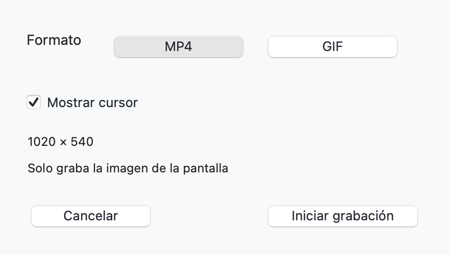
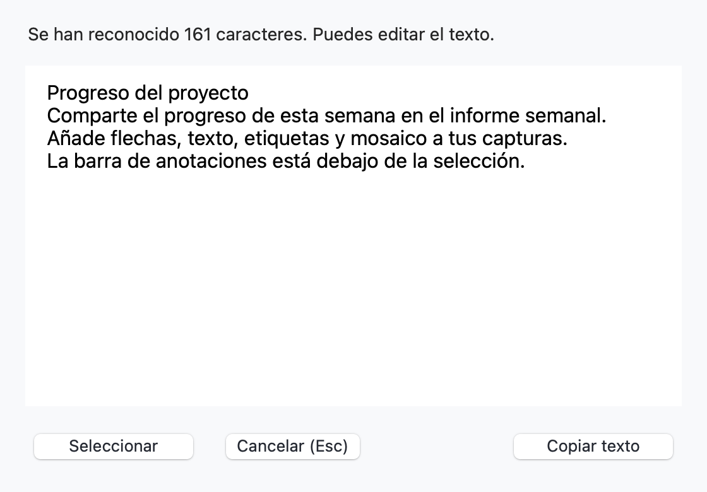
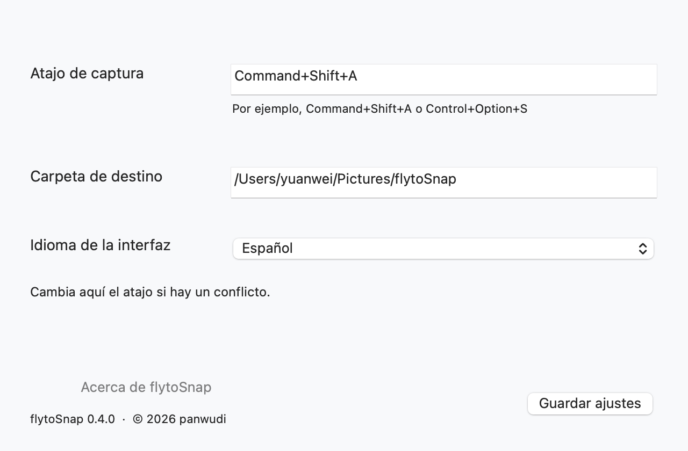
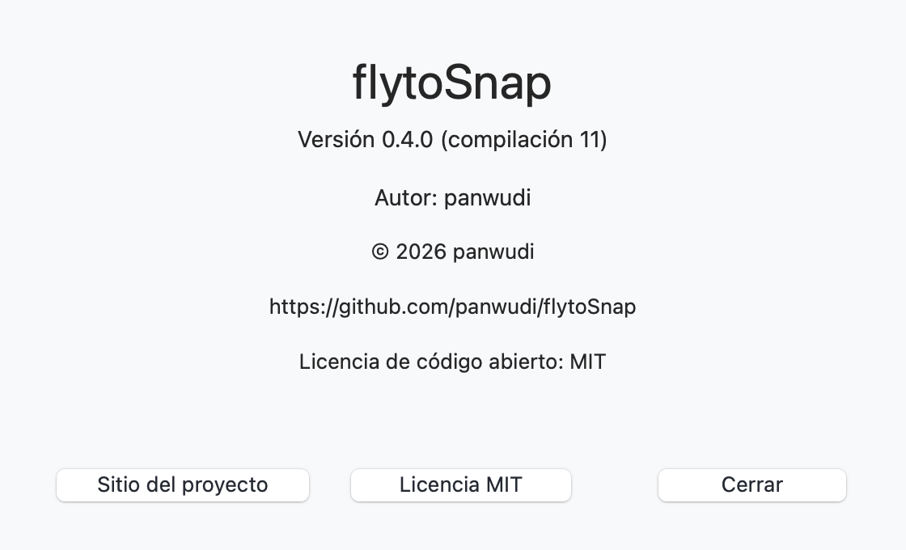

# flytoSnap

**[简体中文](README.zh-CN.md) | [繁體中文](README.zh-TW.md) | [English](README.en.md) | [日本語](README.ja.md) | [Русский](README.ru.md) | [Français](README.fr.md) | [Español](README.es.md) | [Português](README.pt.md) | [Deutsch](README.de.md) | [한국어](README.ko.md)**

[flytoSnap](README.md)

Una herramienta de capturas y grabación para macOS, creada con Rust y AppKit.

macOS 14+ · Apple Silicon · MIT

[Descargar la última versión](https://github.com/panwudi/flytoSnap/releases/latest)

Descomprime el ZIP y mueve la aplicación a Aplicaciones. Se inicia en la barra de menús.

## Uso

`Command+Shift+A` para elegir un modo y seleccionar una zona.

Anotaciones, capturas con desplazamiento, grabación MP4/GIF y reconocimiento de texto local.

Elige el idioma en Ajustes. Las ventanas de actualización usan el mismo idioma.

## Acerca de

Consulta la versión, la compilación, el autor, los derechos de autor y los enlaces del proyecto.

[GitHub](https://github.com/panwudi/flytoSnap) · [MIT](LICENSE)
