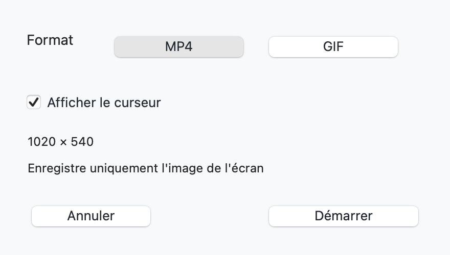
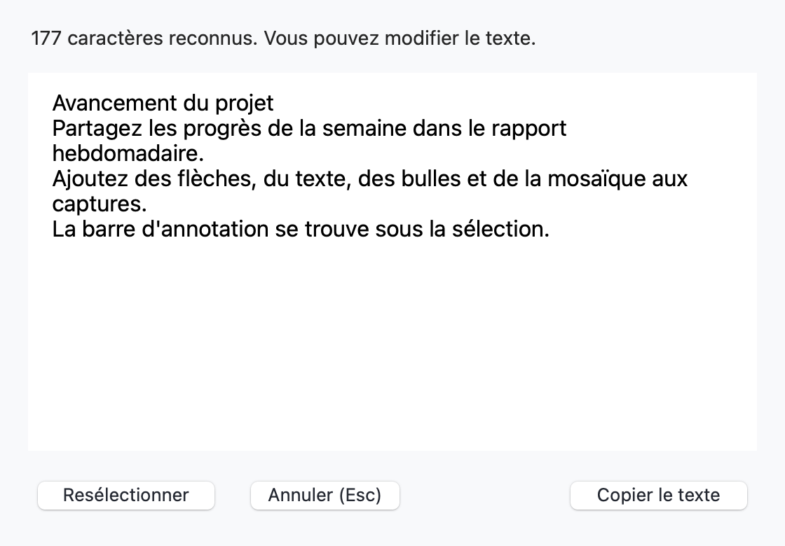
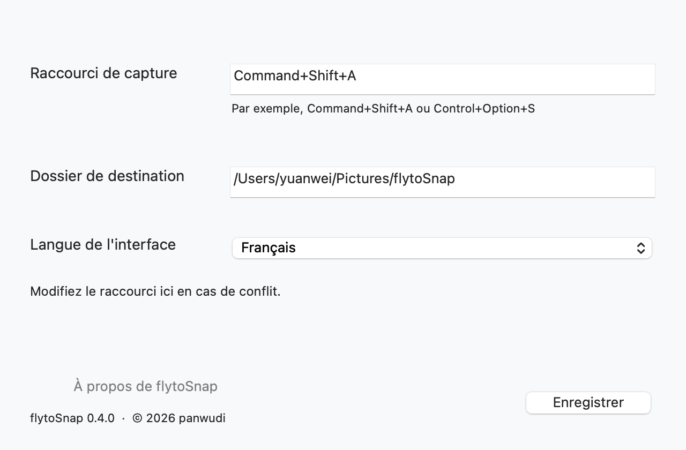
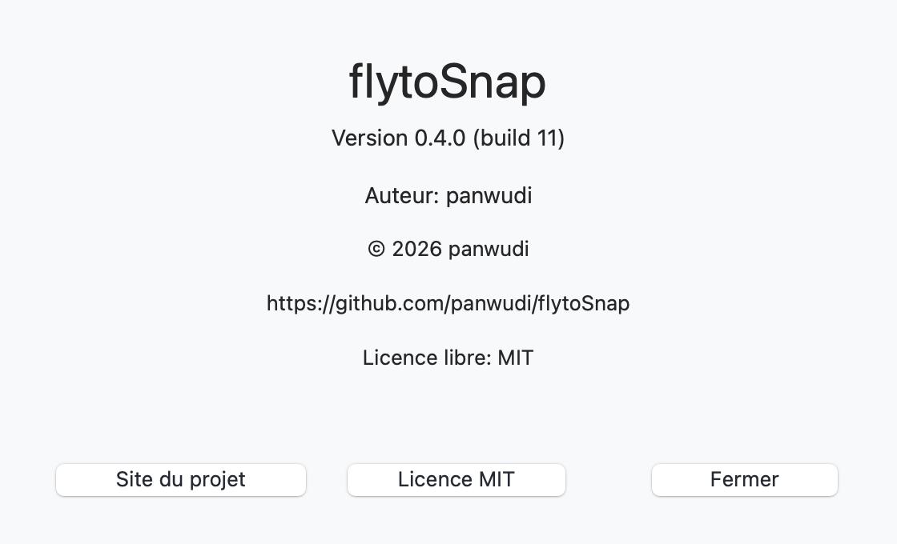

# flytoSnap

**[简体中文](README.zh-CN.md) | [繁體中文](README.zh-TW.md) | [English](README.en.md) | [日本語](README.ja.md) | [Русский](README.ru.md) | [Français](README.fr.md) | [Español](README.es.md) | [Português](README.pt.md) | [Deutsch](README.de.md) | [한국어](README.ko.md)**

[flytoSnap](README.md)

Un outil de capture et d'enregistrement pour macOS, écrit en Rust avec AppKit.

macOS 14+ · Apple Silicon · MIT

[Télécharger la dernière version](https://github.com/panwudi/flytoSnap/releases/latest)

Décompressez le ZIP et placez l'application dans Applications. Elle reste dans la barre des menus.

## Utilisation

`Command+Shift+A` pour choisir un mode et sélectionner une zone.

Annotations, capture défilante, enregistrement MP4/GIF et reconnaissance de texte locale.

Choisissez la langue dans les réglages. Les fenêtres de mise à jour suivent ce choix.

## À propos

Consultez la version, le numéro de build, l'auteur, le copyright et les liens du projet.

[GitHub](https://github.com/panwudi/flytoSnap) · [MIT](LICENSE)
