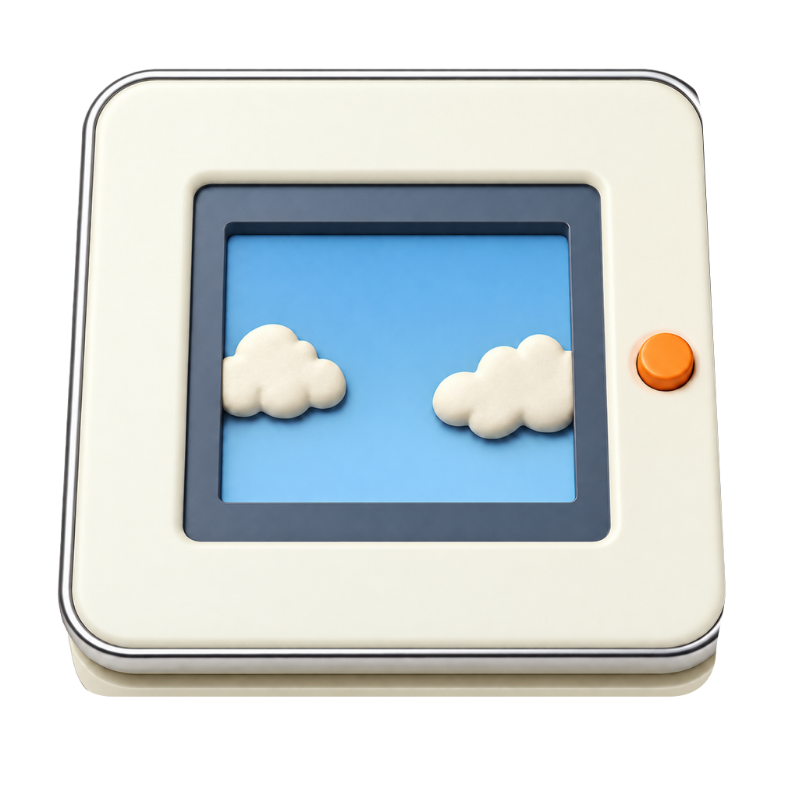
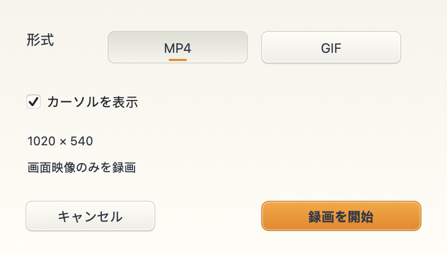
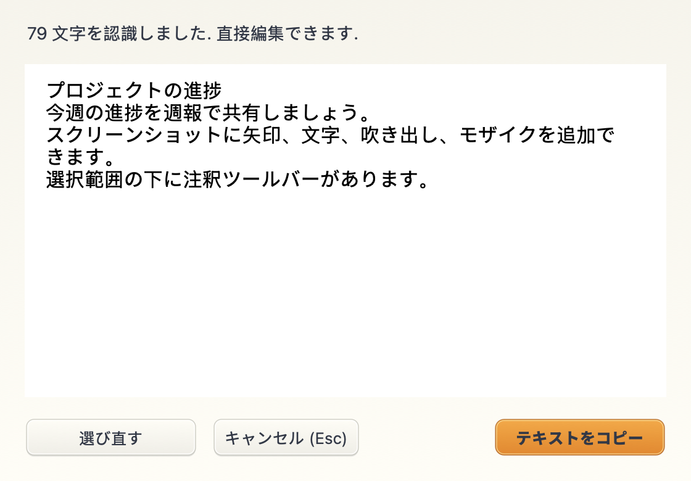
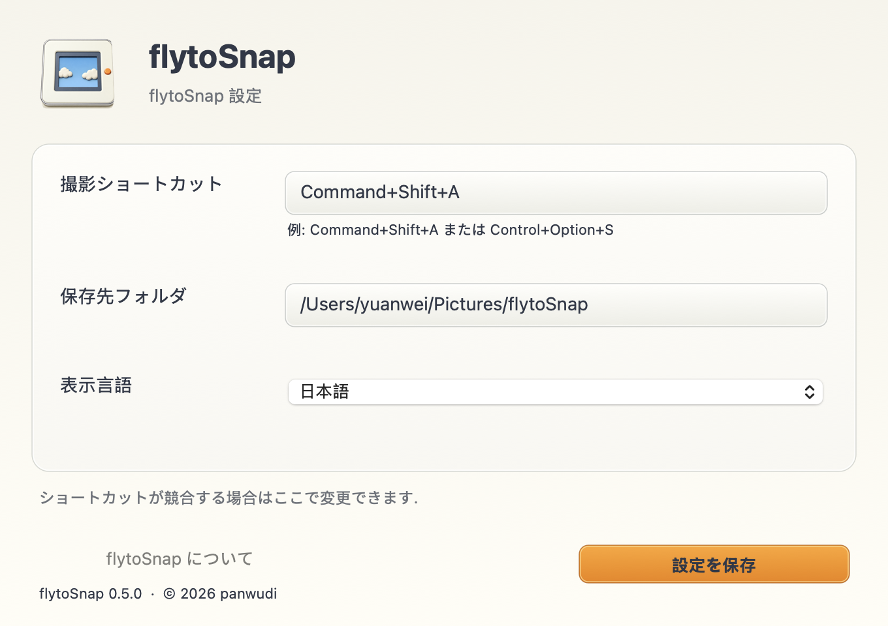
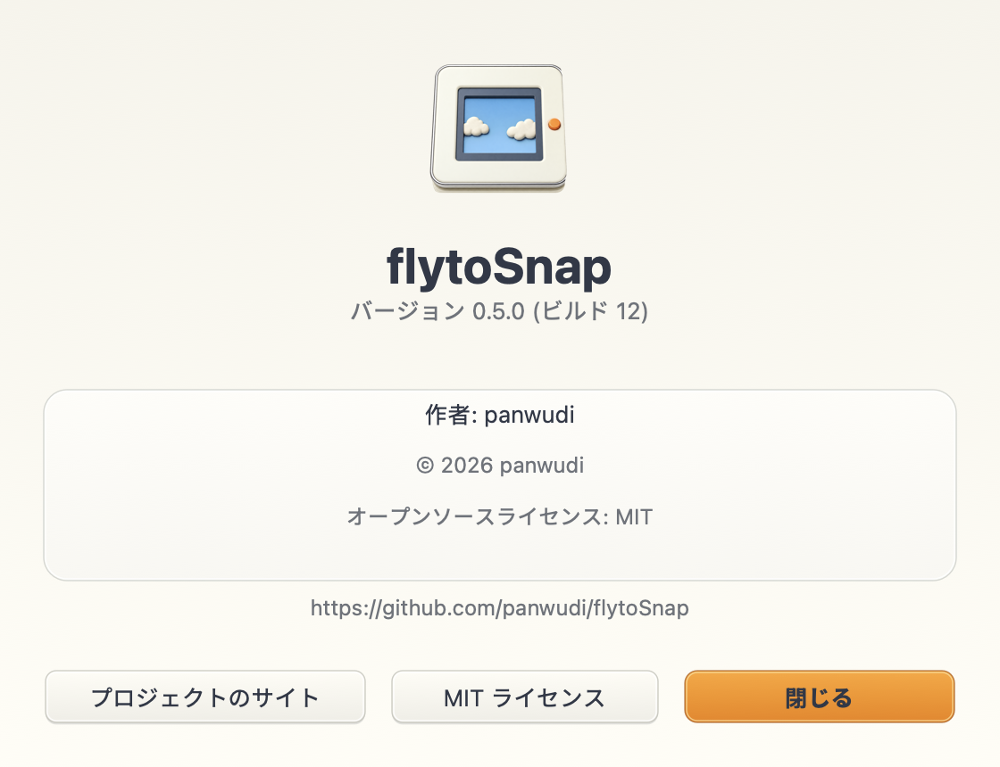

# flytoSnap

**[简体中文](README.zh-CN.md) | [繁體中文](README.zh-TW.md) | [English](README.en.md) | [日本語](README.ja.md) | [Русский](README.ru.md) | [Français](README.fr.md) | [Español](README.es.md) | [Português](README.pt.md) | [Deutsch](README.de.md) | [한국어](README.ko.md)**

[flytoSnap](README.md)

Rust と AppKit で作られた macOS 用のスクリーンショットと画面録画ツール.

macOS 14+ · Apple Silicon · MIT

[最新バージョンをダウンロード](https://github.com/panwudi/flytoSnap/releases/latest)

ZIP を展開してアプリケーションフォルダへ移動します. 起動後はメニューバーに常駐します.

## 使い方

`Command+Shift+A` でモードを選び, 範囲を指定します.

スクリーンショットの編集, スクロール撮影, MP4/GIF 録画, ローカル文字認識に対応.

設定で表示言語を選べます. 更新画面も同じ言語になります.

## このアプリについて

バージョン, ビルド番号, 作者, 著作権, プロジェクトのリンクを確認できます.

[GitHub](https://github.com/panwudi/flytoSnap) · [MIT](LICENSE)
