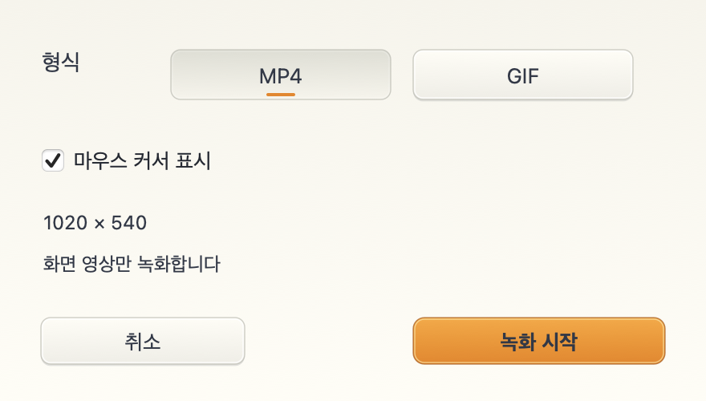
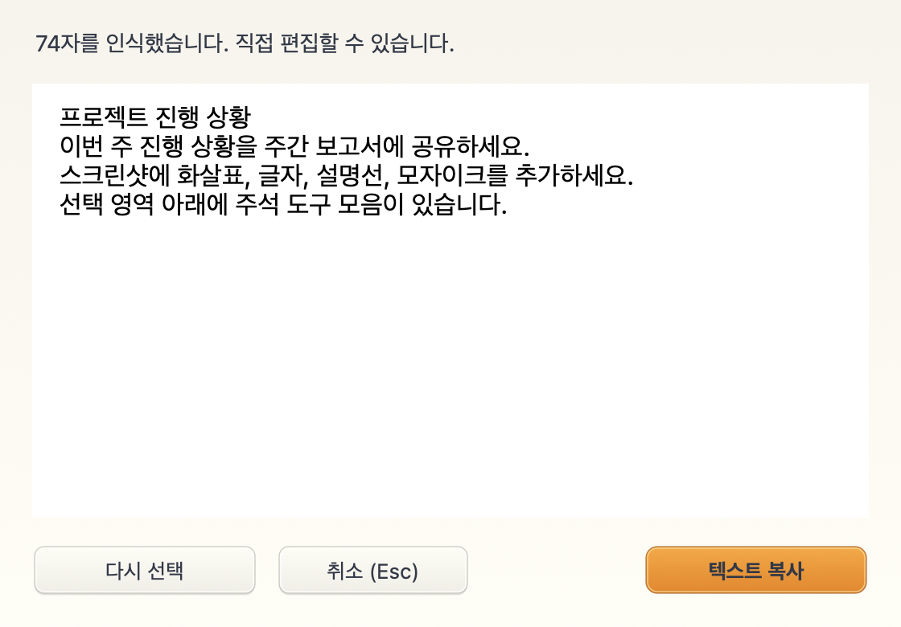
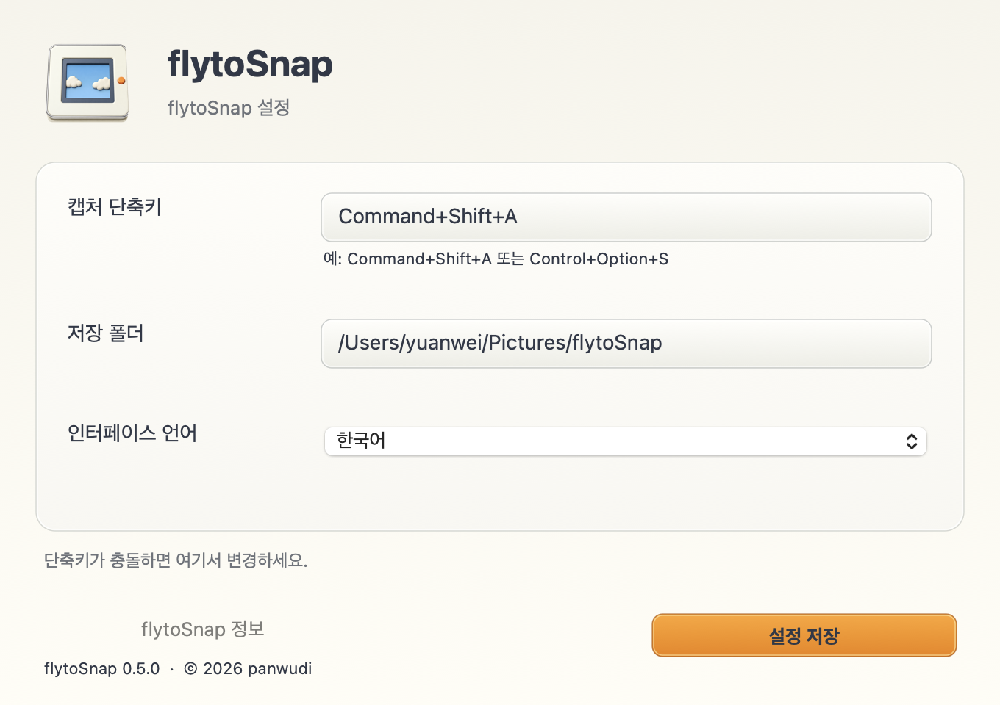
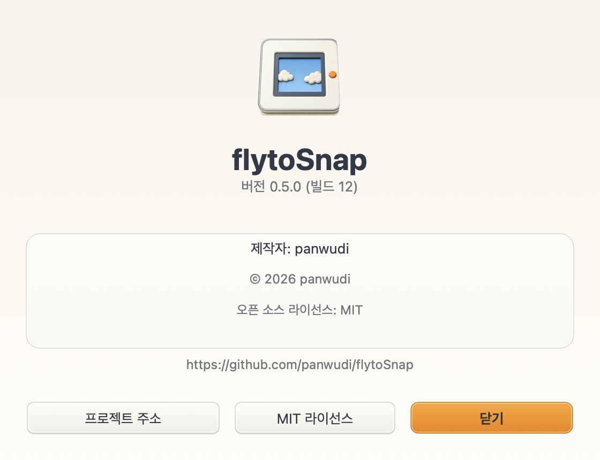

# flytoSnap

**[简体中文](README.zh-CN.md) | [繁體中文](README.zh-TW.md) | [English](README.en.md) | [日本語](README.ja.md) | [Русский](README.ru.md) | [Français](README.fr.md) | [Español](README.es.md) | [Português](README.pt.md) | [Deutsch](README.de.md) | [한국어](README.ko.md)**

[flytoSnap](README.md)

Rust와 AppKit으로 만든 macOS 스크린샷 및 화면 녹화 도구입니다.

macOS 14+ · Apple Silicon · MIT

[최신 버전 다운로드](https://github.com/panwudi/flytoSnap/releases/latest)

ZIP을 풀어 앱을 응용 프로그램 폴더로 옮기세요. 실행하면 메뉴 막대에 표시됩니다.

## 사용 방법

`Command+Shift+A` 키로 모드를 선택하고 영역을 지정하세요.

주석, 스크롤 캡처, MP4/GIF 녹화, 기기 내 텍스트 인식을 지원합니다.

설정에서 표시 언어를 선택하세요. 업데이트 창에도 같은 언어가 적용됩니다.

## 앱 정보

버전, 빌드, 제작자, 저작권과 프로젝트 링크를 확인할 수 있습니다.

[GitHub](https://github.com/panwudi/flytoSnap) · [MIT](LICENSE)
