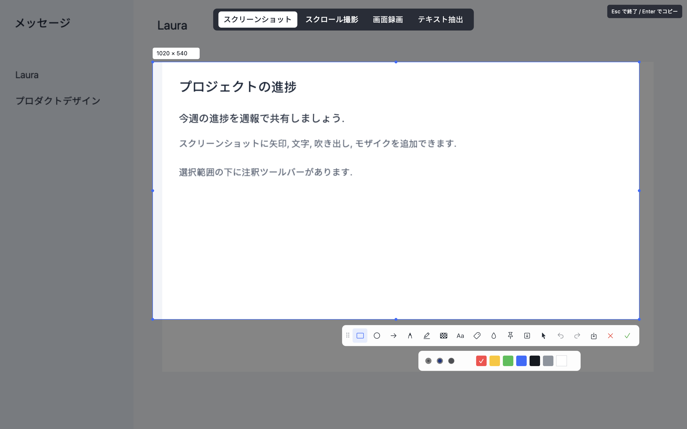
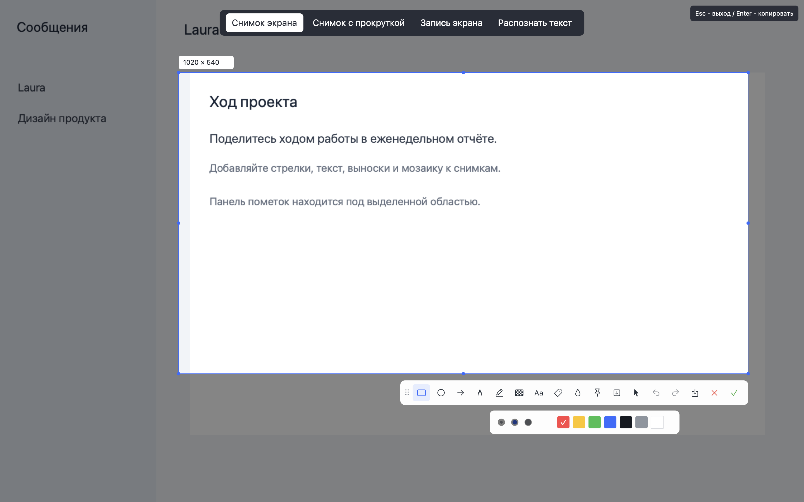
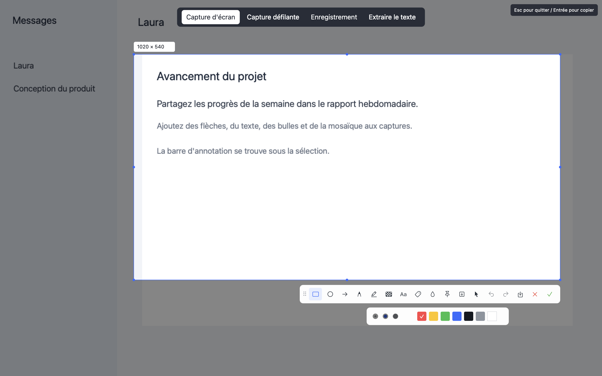
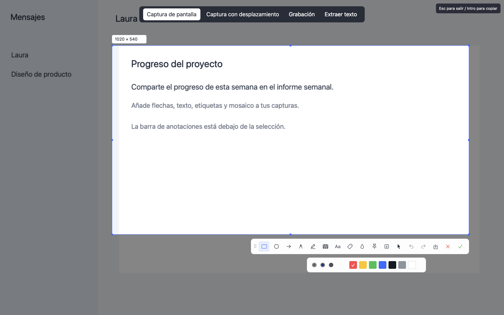
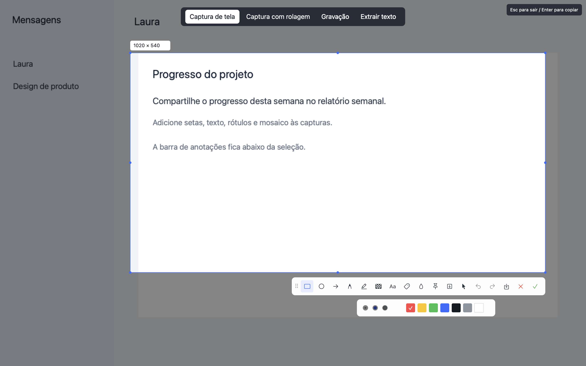
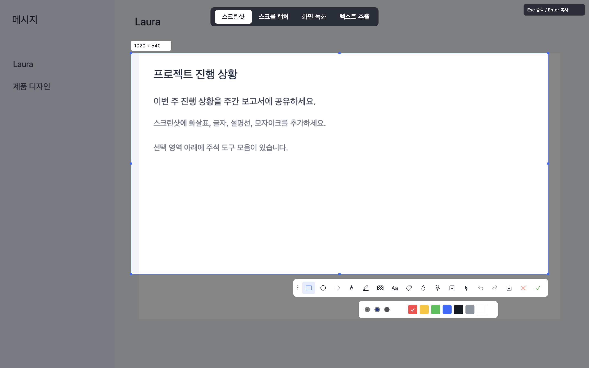

# flytoSnap

**[简体中文](README.zh-CN.md) | [繁體中文](README.zh-TW.md) | [English](README.en.md) | [日本語](README.ja.md) | [Русский](README.ru.md) | [Français](README.fr.md) | [Español](README.es.md) | [Português](README.pt.md) | [Deutsch](README.de.md) | [한국어](README.ko.md)**

**[下载最新版本 / 下載最新版本 / Download latest release](https://github.com/panwudi/flytoSnap/releases/latest)**

原生 macOS 截图与录屏工具. Rust + AppKit, 一个快捷键完成截图, 滚动截图, MP4/GIF 录屏和文字提取.

原生 macOS 截圖與錄影工具. Rust + AppKit, 一個快捷鍵完成截圖, 捲動截圖, MP4/GIF 錄影與文字擷取.

A native macOS capture app built with Rust and AppKit. One shortcut for screenshots, scrolling capture, MP4/GIF recording, and text extraction.

macOS 14+ · Apple Silicon · MIT · `Command+Shift+A`

## 十种语言 / 十種語言 / Ten languages

Choose a language above for a guide with matching interface screenshots. Update dialogs follow the language selected in Settings.

| 简体中文 | 繁體中文 | English |
| --- | --- | --- |
| [](README.zh-CN.md) | [](README.zh-TW.md) | [](README.en.md) |
| [使用说明](README.zh-CN.md) | [使用說明](README.zh-TW.md) | [User guide](README.en.md) |

| 日本語 | Русский | Français |
| --- | --- | --- |
| [](README.ja.md) | [](README.ru.md) | [](README.fr.md) |

| Español | Português | Deutsch | 한국어 |
| --- | --- | --- | --- |
| [](README.es.md) | [](README.pt.md) | [](README.de.md) | [](README.ko.md) |

## 安装与更新 / 安裝與更新 / Install and update

**简体中文**: 从 [Releases](https://github.com/panwudi/flytoSnap/releases/latest) 下载 ZIP, 解压并放入应用程序文件夹.
**繁體中文**: 從 [Releases](https://github.com/panwudi/flytoSnap/releases/latest) 下載 ZIP, 解壓縮並放入應用程式資料夾.
**English**: Download the ZIP from [Releases](https://github.com/panwudi/flytoSnap/releases/latest), unzip, and move the app into Applications.

0.3.0+ 支持应用内检查更新与自动更新. 0.3.0+ 支援應用程式內檢查更新與自動更新. Version 0.3.0+ includes in-app update checks and automatic updates through [Sparkle](https://sparkle-project.org/).

录屏先保存在临时目录, 选择保存才导出. 錄影先放入暫存目錄, 選擇儲存才匯出. Recordings stay temporary until you choose Save.

## 开发 / 開發 / Development

```sh
bash scripts/build-app.sh
cargo test
cargo clippy --all-targets -- -D warnings
```

More build and verification instructions: [简体中文](README.zh-CN.md#构建和使用), [繁體中文](README.zh-TW.md#建置與使用), [English](README.en.md#build-and-use).

MIT. See [LICENSE](LICENSE). Screenshot interactions follow Feishu; the icon uses the FLYTO brand colors and frame mark. The screenshots above use built-in example content.
