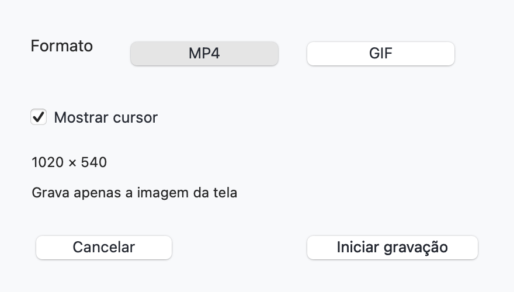
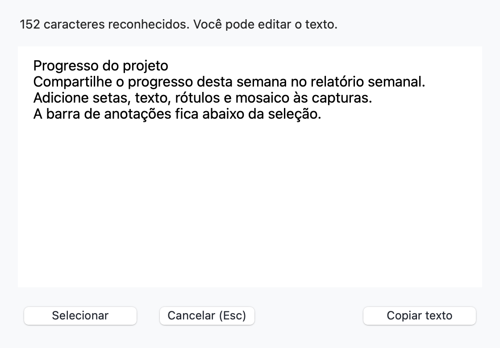
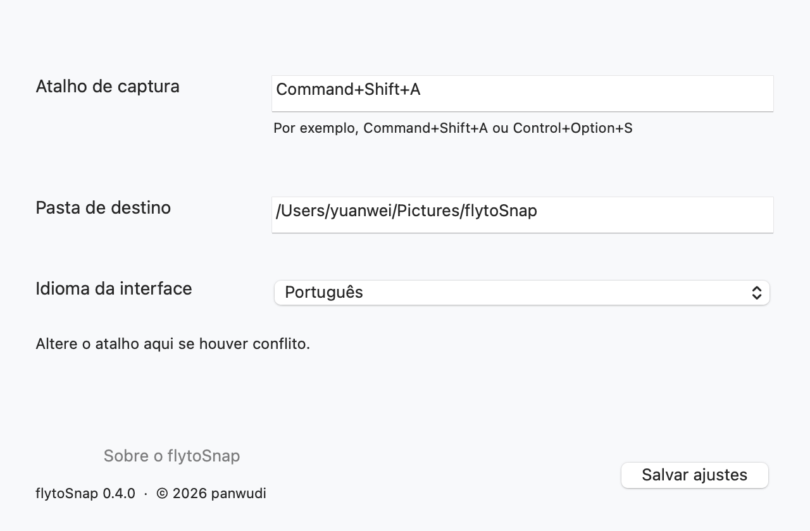
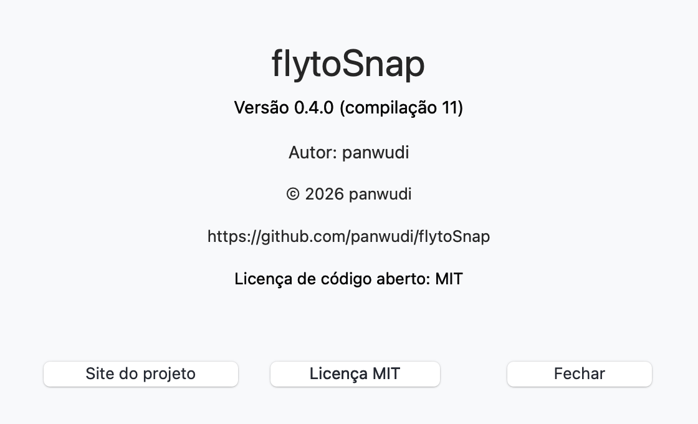

# flytoSnap

**[简体中文](README.zh-CN.md) | [繁體中文](README.zh-TW.md) | [English](README.en.md) | [日本語](README.ja.md) | [Русский](README.ru.md) | [Français](README.fr.md) | [Español](README.es.md) | [Português](README.pt.md) | [Deutsch](README.de.md) | [한국어](README.ko.md)**

[flytoSnap](README.md)

Uma ferramenta de captura e gravação para macOS, feita com Rust e AppKit.

macOS 14+ · Apple Silicon · MIT

[Baixar a versão mais recente](https://github.com/panwudi/flytoSnap/releases/latest)

Extraia o ZIP e mova o aplicativo para Aplicativos. Ele inicia na barra de menus.

## Como usar

`Command+Shift+A` para escolher um modo e selecionar uma área.

Anotações, captura com rolagem, gravação MP4/GIF e reconhecimento de texto local.

Escolha o idioma nos Ajustes. As janelas de atualização seguem essa escolha.

## Sobre

Veja a versão, a compilação, o autor, os direitos autorais e os links do projeto.

[GitHub](https://github.com/panwudi/flytoSnap) · [MIT](LICENSE)
