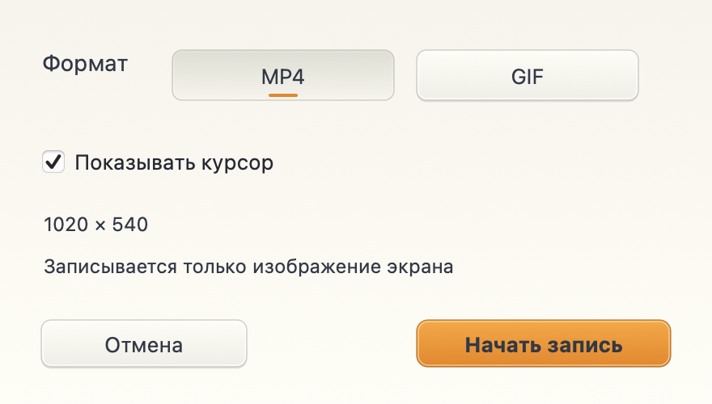
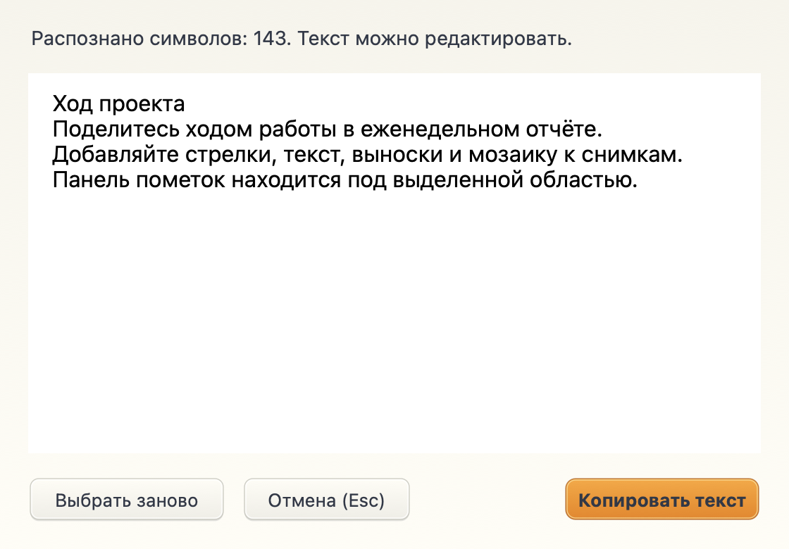
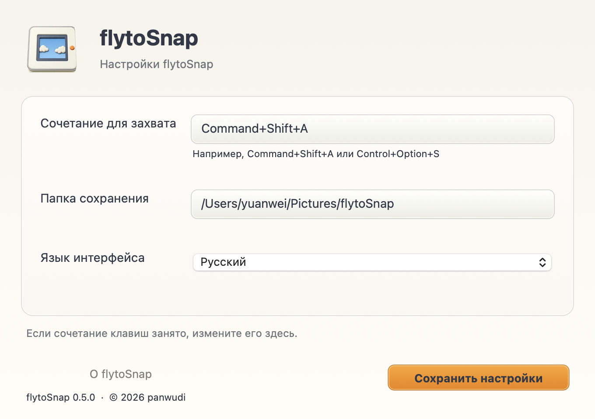
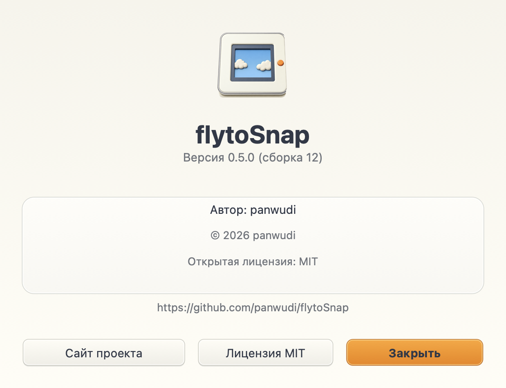

# flytoSnap

**[简体中文](README.zh-CN.md) | [繁體中文](README.zh-TW.md) | [English](README.en.md) | [日本語](README.ja.md) | [Русский](README.ru.md) | [Français](README.fr.md) | [Español](README.es.md) | [Português](README.pt.md) | [Deutsch](README.de.md) | [한국어](README.ko.md)**

[flytoSnap](README.md)

Инструмент снимков экрана и записи для macOS на Rust и AppKit.

macOS 14+ · Apple Silicon · MIT

[Скачать последнюю версию](https://github.com/panwudi/flytoSnap/releases/latest)

Распакуйте ZIP и перенесите приложение в папку Applications. После запуска оно находится в строке меню.

## Использование

`Command+Shift+A` откройте выбор режима и выделите область.

Аннотации, снимки с прокруткой, запись MP4/GIF и локальное распознавание текста.

Язык выбирается в настройках. Окна обновления используют тот же язык.

## О приложении

Здесь указаны версия, сборка, автор, авторские права и ссылки на проект.

[GitHub](https://github.com/panwudi/flytoSnap) · [MIT](LICENSE)
