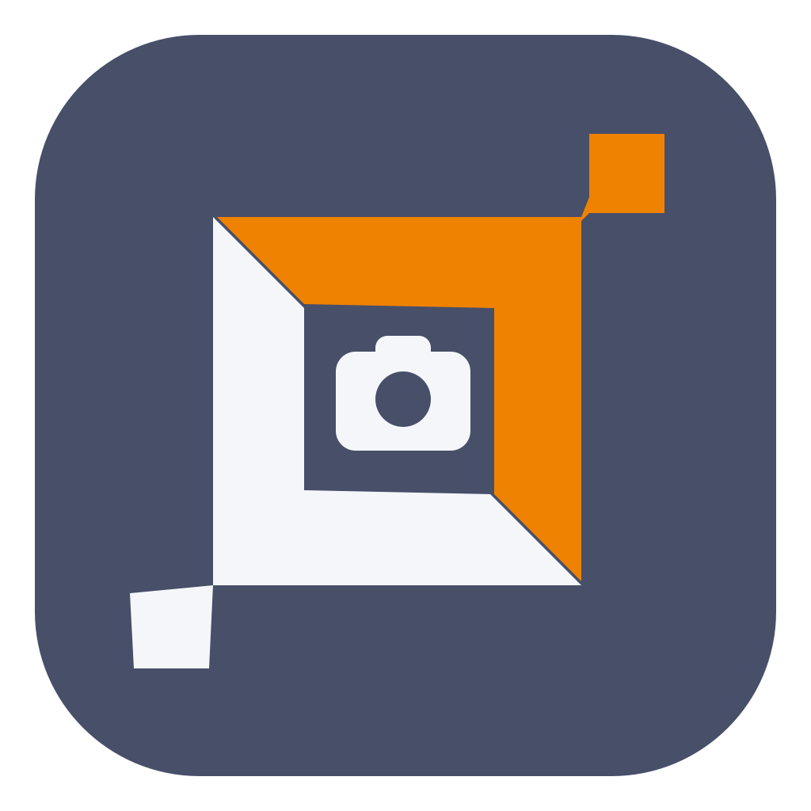
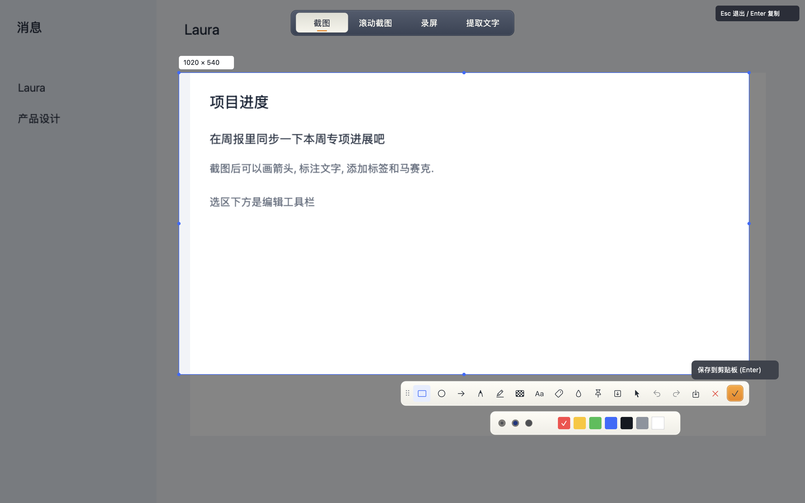
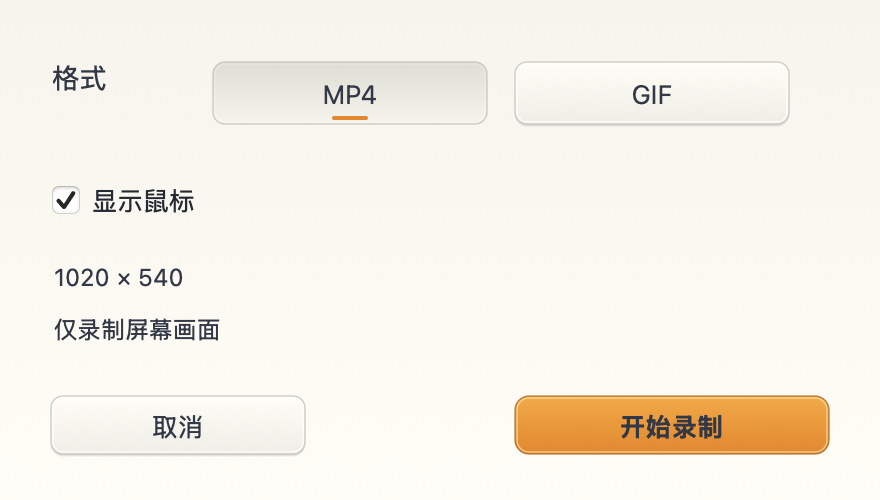
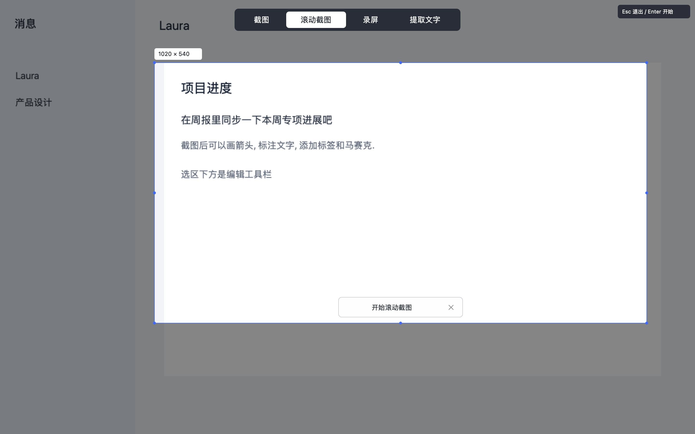
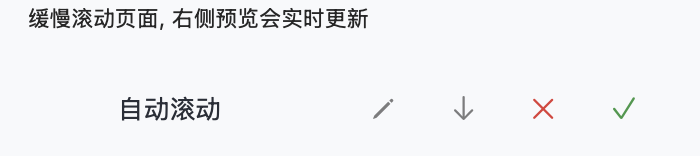
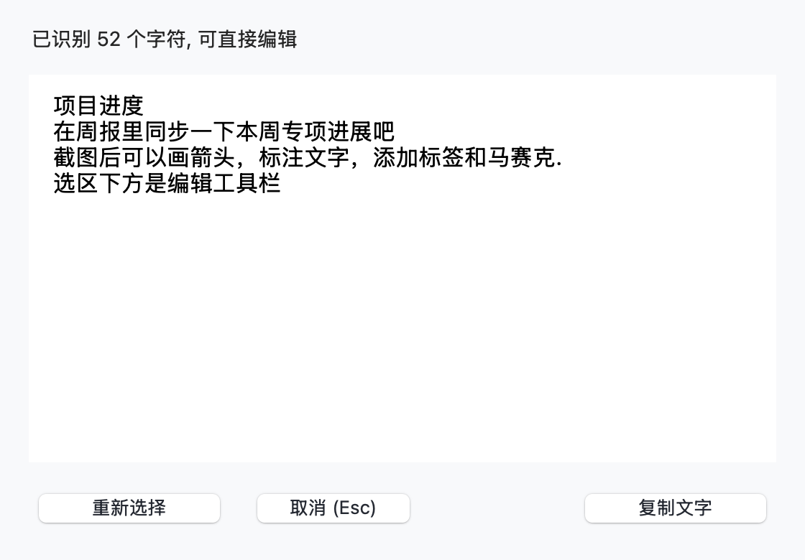

# flytoSnap

**[简体中文](README.zh-CN.md) | [繁體中文](README.zh-TW.md) | [English](README.en.md)**

[Home / 首页 / 首頁](README.md)

原生 macOS 截图和录屏工具, 使用 Rust 实现. 按一个快捷键, 即可在截图, 滚动截图, 录屏和提取文字之间切换.

支持 macOS 14+, 界面支持简体中文, 繁体中文和英语, 默认跟随系统语言. 启动后驻留菜单栏, 不自动打开主窗口.



## 功能

- 截图: 自动识别窗口, 自由框选, 放大镜, 八个调整点. 选区外变暗, 光标随按钮, 边缘, 角点和文字区域变化.
- 标注: 矩形, 椭圆, 箭头, 画笔, 高亮, 两种马赛克, 文字, 气泡标签和水印. 支持撤销, 重做和重新编辑.
- 贴图: 置顶, 拖动, 缩放, 透明度, 锁定, 复制和保存.
- 滚动截图: 选区后点击开始滚动截图, 再手动或自动滚动. 紧凑控制栏和侧边预览保持可见, 支持双向拼接, 回滚去重, 编辑, 保存和复制.
- 录屏: 选择区域, MP4 或 GIF, 可选择显示鼠标. 停止后可预览, 保存或复制到支持文件的应用中粘贴.
- 提取文字: 使用本机 Apple Vision, 结果可编辑和复制. 无需额外下载模型.



选区后先确认开始, 再选择自动滚动:





以上为应用原生控件的离屏截图, 内容来自内置演示数据.

## 文字提取

按 `Command+Shift+A`, 选择提取文字并框选区域. 识别在本机完成, 支持简体中文, 繁体中文和英语, 图片与文字不会上传.

结果可以直接编辑; 点击复制文字复制全部内容, 或在文字框中选中部分内容后按 `Command+C`. 重新选择可重画区域; 取消, `Escape` 和关闭结果窗口都会退出本次截图. 空白区域或识别失败会显示提示.



## 下载与自动更新

[下载最新 macOS 版本](https://github.com/panwudi/flytoSnap/releases/latest) (Apple Silicon, macOS 14+). 解压后将 flytoSnap.app 放入应用程序文件夹.

从 0.3.0 起, 菜单栏提供检查更新和自动更新开关. 默认每天检查并下载签名更新, 退出应用时安装; 截图和录屏期间延后更新. 旧的 0.2.x 版本需要先手动安装一次.

## 构建和使用

需要 Rust 工具链和 macOS SDK.

```sh
bash scripts/build-app.sh
open dist/flytoSnap.app
```

构建脚本生成本地签名的 `.app`, 应用图标和 ZIP 测试包. 首次截图或录屏需要在 macOS 中允许屏幕录制权限, 授权后可能需要重新打开应用. 自动滚动另需辅助功能权限.

首次启动时检查并请求尚未授予的屏幕录制权限; 已授权时不重复弹窗. 菜单栏提供取消入口. 普通截图切换到其他应用时自动收起, 滚动截图的控制栏保持可见. 截图会话中按 `Escape`, 再按截图快捷键或点击取消均可退出. 再次打开已运行的应用会显示操作菜单, 不打开主窗口.

默认入口为 `Command+Shift+A`. 截图界面顶部可选择四种模式, 每个工具都有悬停提示. 在菜单栏的设置中可以更改快捷键, 保存目录和界面语言.

| 操作 | 快捷键 |
| --- | --- |
| 呼出截图和模式选择 | `Command+Shift+A` |
| 复制截图 | `Enter` 或 `Command+C` |
| 保存截图 | `Command+S` |
| 撤销 / 重做 | `Command+Z` / `Command+Shift+Z` |
| 退出截图 | `Escape` |
| 退出应用 | `Command+Q` |

贴图上滚动可缩放, `Option+滚动` 调整透明度, 右键打开操作菜单. 录屏的复制使用 macOS 文件剪贴板; GIF 同时提供动画数据, 粘贴效果取决于目标应用支持的格式. 录屏先生成临时结果, 点击保存才导出到所选位置. 关闭结果会清理未使用的临时文件; 已复制的录屏保留到剪贴板更新, 退出应用后仍可粘贴, 下次启动时清理失效文件.

## 升级后权限无法生效

旧版测试包使用临时签名, 新版改为稳定的开发者证书签名. 这次签名身份切换需要重新授权. 应用提供打开系统设置, 显示当前应用和重新检测, 不自动重置系统权限.

1. 从菜单栏退出 flytoSnap. 将新版放到固定位置, 建议 `/Applications/flytoSnap.app`.
2. 打开系统设置 -> 隐私与安全性 -> 屏幕与系统音频录制 (旧系统显示屏幕录制).
3. 如果已有 flytoSnap 且开启开关仍无法截图, 移除旧条目, 通过 `+` 添加当前新版, 再打开开关.
4. 完全退出并重新打开应用. 必须替换权限列表中的旧条目, 仅打开旧条目的开关可能无效.

构建脚本优先使用本机 Developer ID Application 证书, 其次为 Apple Development 证书. 可用 `FLYTOSNAP_SIGNING_IDENTITY` 指定证书名称或指纹. 无有效证书时退回临时签名并显示警告, 此类包升级后可能需要重新授权. 后续构建请保持相同证书类型, 开发团队和应用标识. 构建脚本不改变钥匙串信任设置.

## 验证

```sh
cargo test
cargo clippy --all-targets -- -D warnings
cargo run -- --self-check target/self-check
cargo run -- --ui-snapshot target/ui-check --lang zh-CN
cargo run -- --window-check
```

后三项不在工作区显示应用窗口. 检查覆盖编辑几何, 光标区域, 遮罩, 语言文本, 原生控件, Retina 裁剪, 系统 OCR, GIF 动画和 H.264 MP4 封装. `--window-check` 使用屏幕外的真实原生窗口, 检查 WindowServer 层级, 遮挡检测, 按钮命中, 窗口事件分发, 录屏格式切换和取消. 此检查不录制屏幕或请求权限.

以下命令会短暂显示真实菜单栏图标约一秒, 不打开主窗口或请求权限:

```sh
dist/flytoSnap.app/Contents/MacOS/flytosnap --menubar-check
```

当前录屏仅包含屏幕画面, 不录制声音或摄像头. 自动滚动拼接适合静态页面; 避免固定页头, 滚动条, 动画和视频. 长图上限为 8000 万像素和 32000 像素高. 发布包使用 Developer ID 签名及 Sparkle 更新签名. Apple 公证状态以 Release 说明为准.

## 参考和许可证

交互参考 [飞书截图](https://www.feishu.cn/hc/zh-CN/articles/319286513754) 和 [滚动截图](https://www.feishu.cn/hc/zh-CN/articles/145659580677). 原生接口使用 [objc2](https://github.com/madsmtm/objc2).

MIT, 见 [LICENSE](LICENSE). 图标沿用 FLYTO 蓝灰色, 橙色和对角框形品牌标记, 加入相机元素.
