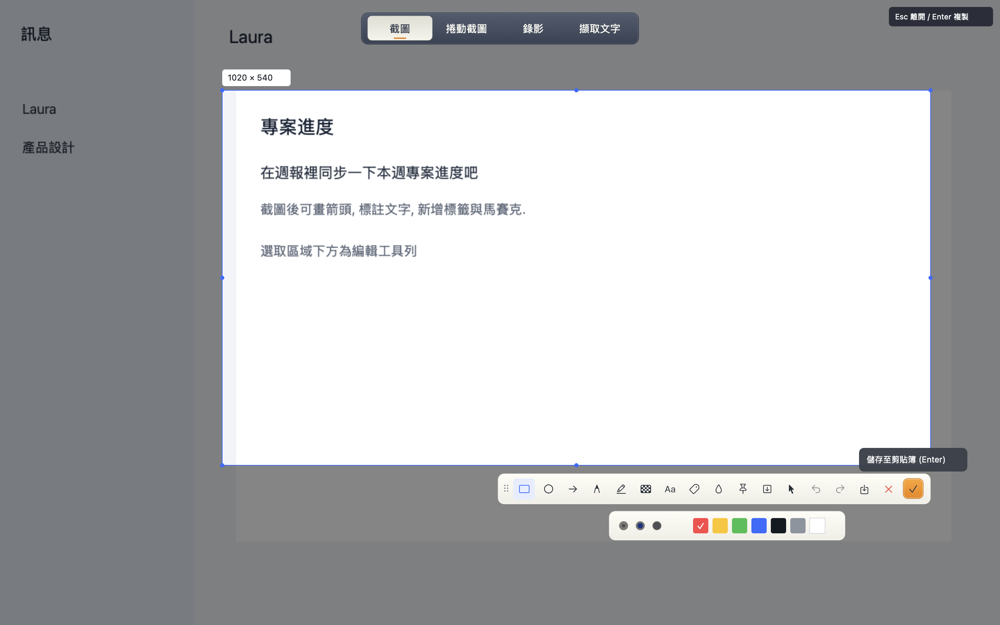
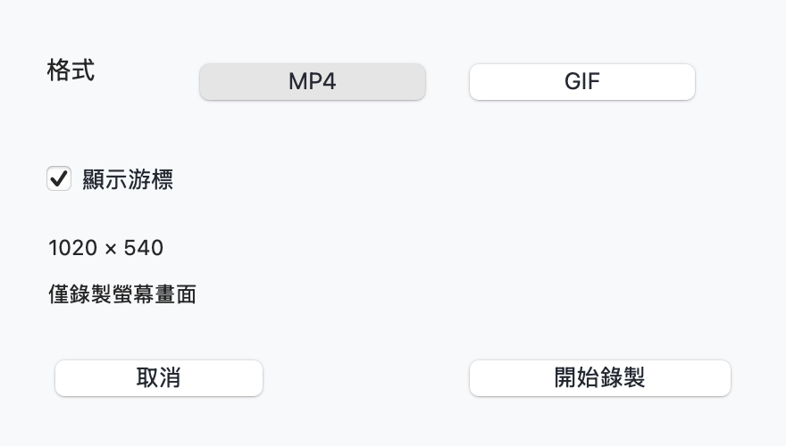

# flytoSnap

[简体中文](README.md) | 繁體中文 | [English](README.en.md)

原生 macOS 截圖與錄影工具, 使用 Rust 實作. 按一個快捷鍵, 即可在截圖, 捲動截圖, 錄影和擷取文字之間切換.

支援 macOS 14+, 介面支援簡體中文, 繁體中文和英語, 預設跟隨系統語言. 啟動後駐留選單列, 不自動開啟主視窗.



## 功能

- 截圖: 自動辨識視窗, 自由框選, 放大鏡與八個調整點. 選取區域外變暗, 游標隨按鈕, 邊緣, 角點和文字區域變化.
- 標註: 矩形, 橢圓, 箭頭, 畫筆, 螢光標記, 兩種馬賽克, 文字, 氣泡標籤和浮水印. 支援復原, 重做和重新編輯.
- 貼圖: 置頂, 拖曳, 縮放, 透明度, 鎖定, 複製和儲存.
- 捲動截圖: 手動或自動捲動, 雙向拼接, 往回捲動去重, 預覽與繼續標註.
- 錄影: 選擇區域, MP4 或 GIF, 可選擇顯示游標. 停止後可預覽, 儲存或複製至支援檔案的應用程式中貼上.
- 擷取文字: 使用本機 Apple Vision, 結果可編輯與複製. 不需另行下載模型.



以上為應用程式原生控制項的離屏截圖, 內容來自內建示範資料.

## 建置與使用

需要 Rust 工具鏈和 macOS SDK.

```sh
bash scripts/build-app.sh
open dist/flytoSnap.app
```

建置腳本產生本機簽署的 `.app`, 應用程式圖示和 ZIP 測試包. 首次截圖或錄影需在 macOS 中允許螢幕錄製權限, 授權後可能需要重新開啟應用程式. 自動捲動另需輔助使用權限.

預設入口為 `Command+Shift+A`. 截圖介面上方可選擇四種模式, 每個工具都有滑鼠提示. 在選單列的設定中可以更改快捷鍵, 儲存資料夾與介面語言.

| 操作 | 快捷鍵 |
| --- | --- |
| 開啟截圖與模式選擇 | `Command+Shift+A` |
| 複製截圖 | `Enter` 或 `Command+C` |
| 儲存截圖 | `Command+S` |
| 復原 / 重做 | `Command+Z` / `Command+Shift+Z` |
| 離開截圖 | `Escape` |
| 結束應用程式 | `Command+Q` |

在貼圖上捲動可縮放, `Option+捲動` 調整透明度, 按右鍵開啟操作選單. 錄影的複製使用 macOS 檔案剪貼簿; GIF 同時提供動畫資料, 貼上效果取決於目標應用程式支援的格式. 錄影檔案會保留在本機快取中, 複製後可繼續貼上.

## 升級後權限無法生效

舊版測試包使用臨時簽署, 新版改為穩定的開發者憑證簽署. 這次簽署身分切換需要重新授權. 應用程式提供開啟系統設定, 顯示目前的應用程式和重新檢查, 不自動重設系統權限.

1. 從選單列結束 flytoSnap. 將新版放到固定位置, 建議 `/Applications/flytoSnap.app`.
2. 開啟系統設定 -> 隱私權與安全性 -> 螢幕與系統音訊錄製 (舊系統顯示螢幕錄製).
3. 如果已有 flytoSnap 且開啟開關仍無法截圖, 移除舊項目, 透過 `+` 加入目前的新版, 再開啟開關.
4. 完全結束並重新開啟應用程式. 只開啟舊項目的開關可能無法授權新版.

建置腳本優先使用本機 Developer ID Application 憑證, 其次為 Apple Development 憑證. 可用 `FLYTOSNAP_SIGNING_IDENTITY` 指定憑證名稱或指紋. 沒有有效憑證時退回臨時簽署並顯示警告, 此類包升級後可能需要重新授權. 後續建置請保持相同憑證類型, 開發團隊和應用程式識別碼. 建置腳本不變更鑰匙圈信任設定.

## 驗證

```sh
cargo test
cargo clippy --all-targets -- -D warnings
cargo run -- --self-check target/self-check
cargo run -- --ui-snapshot target/ui-check --lang zh-TW
```

後兩項不顯示應用程式視窗. 檢查涵蓋編輯幾何, 游標區域, 遮罩, 語言文字, 原生控制項, Retina 裁剪, 系統 OCR, GIF 動畫與 H.264 MP4 封裝.

目前錄影僅包含螢幕畫面, 不錄製聲音或攝影機. 自動捲動拼接適合靜態頁面; 避免固定頁首, 捲軸, 動畫和影片. 長圖上限為 8000 萬像素和 32000 像素高. 本機測試包未完成 Developer ID 公證, 正式散布需另外簽署與公證.

## 參考與授權

互動參考 [飛書截圖](https://www.feishu.cn/hc/zh-CN/articles/319286513754) 和 [捲動截圖](https://www.feishu.cn/hc/zh-CN/articles/145659580677). 原生介面使用 [objc2](https://github.com/madsmtm/objc2).

MIT, 請見 [LICENSE](LICENSE). 圖示沿用 FLYTO 藍灰色, 橙色與對角框形品牌標記, 加入相機元素.
